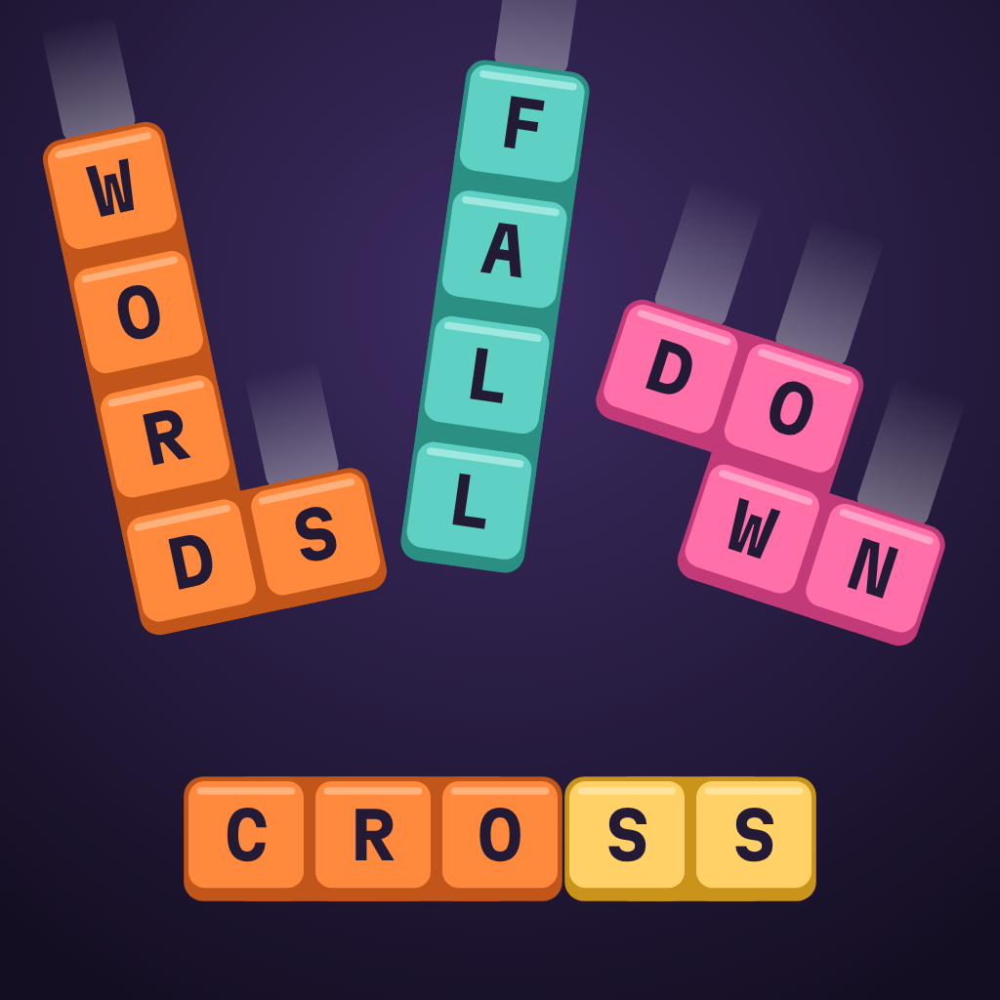
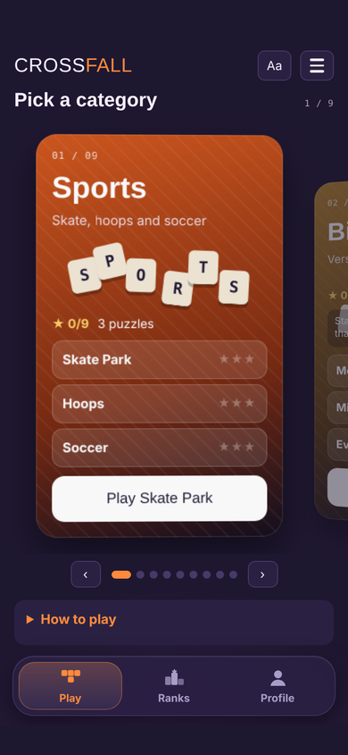
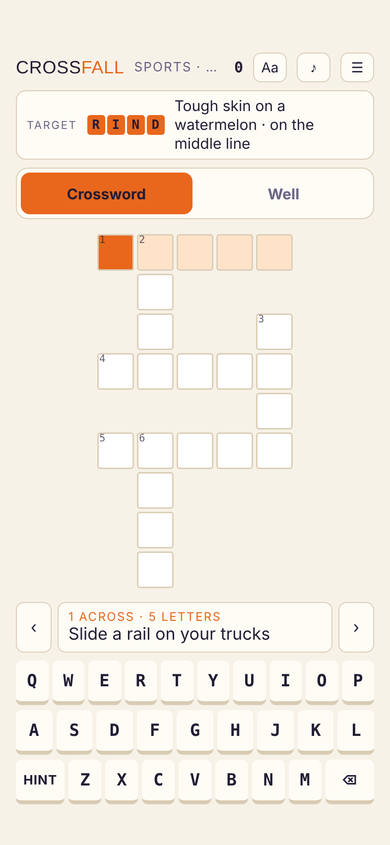
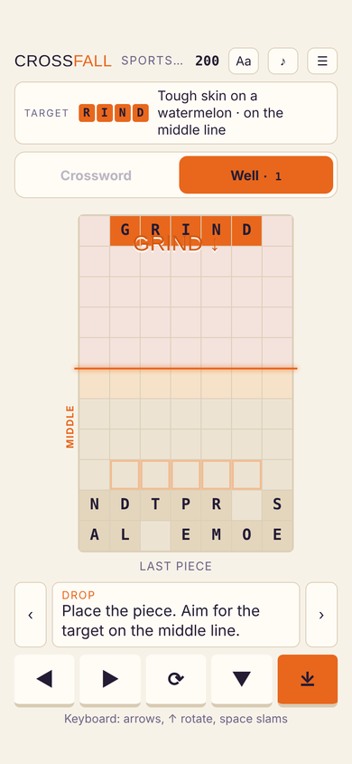
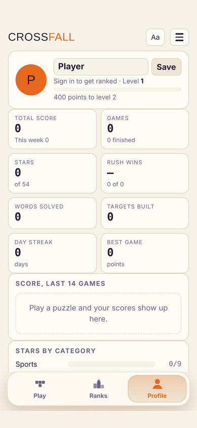
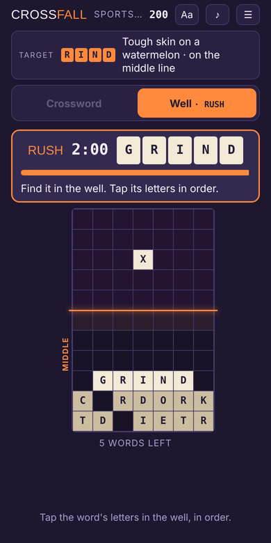
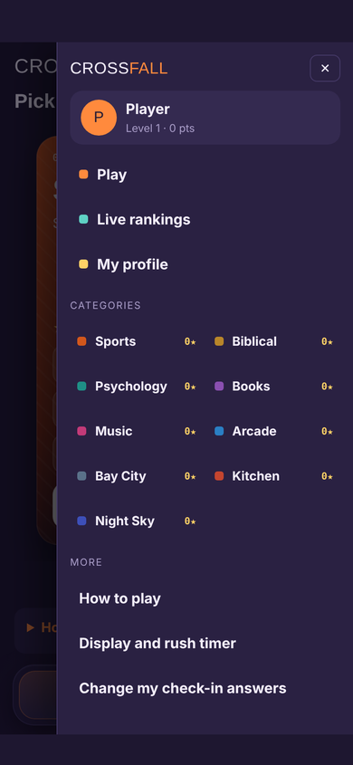
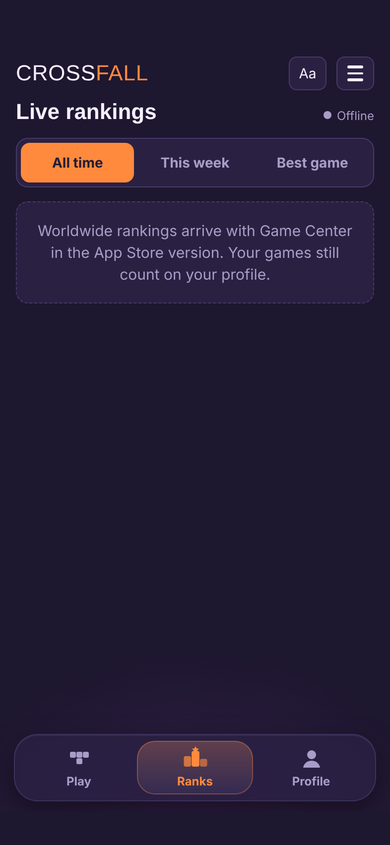

<p align="center">
  
</p>

<h1 align="center">Crossfall</h1>

<p align="center"><b>Solve the crossword. Watch the words fall. Find what's hiding in the stack.</b><br>
A word puzzle game for iPhone that crosses a crossword with a falling-block well.</p>

<p align="center">
  
  
  
  
</p>

---

## Play the beta

Crossfall is in beta on TestFlight. See **[TESTERS.md](TESTERS.md)** for how to join, what to try, and how to send feedback.

## How to play

1. **Solve a clue.** Tap a square and type. Tap the clue bar to switch between Across and Down.
2. **Your word falls.** Every finished word drops into the well as a piece: the whole word, block-style chunks, or one letter at a time, depending on the puzzle. Move it with ◀ ▶, rotate with ⟳, slam it down with ⤓.
3. **Build the target.** Each puzzle has a target word. Spell it across the orange middle line, or down through it, for **+500**. Fill a whole row to clear it.
4. **Win the rush.** When the stack climbs above the middle line, a rush starts: find the hidden word by tapping its letters in the well, unscrambling it, or answering a clue. Win and everything above the line clears. Run out of time and a junk row rises from the bottom.
5. **Earn stars and a grade.** One star for finishing, one for building the target, one for winning every rush. Every game also gets a D–SS grade and a line-by-line score breakdown ([how scoring works](docs/SCORING.md)).

## Features

| | |
| --- | --- |
| **Daily Crossfall** | One puzzle for everyone each day, a Today leaderboard where your first try counts, a streak with freezes earned every 7 days, a 14-day archive and an emoji share card. |
| **Scoring** | Clean letters, speed chains, falling-block row clears with back-to-back and combos, hard drops, target, rushes and a time bonus. Gold solve ×1.2, fall-speed multiplier, D–SS grades. See [docs/SCORING.md](docs/SCORING.md). |
| **Hold and next** | Hold a piece for later (⇄ or C) and see the next three. |
| **Check and Autocheck** | Check the current word, or mark wrong letters as you type. Both cost the gold bonus, and the game says so. |
| **Zen mode** | No rush timer and no game over; scores count at half. |
| **Learn: Life Moves** | A Learn tab where chess, card games, crosswords and falling blocks explain adulting through play. Each game has three quick interactive moves (tap the fork on a chess board, deal out a monthly budget, fill a crossing, drop a piece into a gap). After each move, flip the card to see the real-life version: budgeting, odds, tilt, emergency funds, asking for help. Optional side quests, XP and badges. |
| **Word bank** | Every word you solve is saved with its clue, with 10-card reviews that bring back the ones you missed. |
| **Make a puzzle** | Turn a spelling or study list into a crossword and share it as a code. |
| **Saved progress** | The game in progress survives closing the app. A backup code moves everything to a new phone. |
| **iPad** | On iPad (and any window 700 pt or wider) the crossword and the well sit side by side, so there's no switching tabs. Text and controls scale up, and portrait and landscape both work. |
| **Categories** | Swipeable game cards: Sports (Skate Park, Hoops, Soccer), Biblical, Psychology, Books, Music, Arcade, Bay City, Kitchen and Night Sky. Three puzzles in each. |
| **Personal puzzles** | Biblical, Psychology and Books open with a five-question check-in. The answers choose the words, built around the player's focus: Peace, Hope, Strength, Love, Rest, Courage, Letting go or Gratitude. Clues are King James Version verses, short affirmations and public-domain book quotes, and each one can be read back at the end. |
| **Adaptive rush timer** | Every rush starts at 2:00. Win fast and your next one gets shorter (down to 0:30). Run out of time and it gives time back. Tracked per player and per rush style. |
| **Fall speed** | Relaxed, Normal or Fast. Normal is about 1.3–1.5 s per row with a 2-second pause before each piece starts falling. |
| **Accessibility** | Crossword and well on separate full-width screens, bigger text, high contrast, a readable-font option, a press-and-hold magnifying glass over clues and tiles. The app follows the phone's text size (Dynamic Type), and every square, tile and button is labelled for VoiceOver. |
| **Light and dark mode** | System, Light or Dark from the ☰ menu. Light mode uses a warm off-white. |
| **Sound** | Layered sound effects (solve chime, landing thud, row-clear sparkle, target fanfare, rush riser) and three original music loops: Calm, Drive and Night. |
| **Profile** | Level and XP, total and weekly score, stars, rush win rate, day streak, a score chart and recent games. |
| **Rewards (1.1)** | XP is your lifetime score plus bonuses. Levels unlock 7 well themes (tile skins). Three weekly challenges (same for everyone, new each Monday) give bonus XP, and finishing all three earns a streak freeze. Daily streak milestones at 3, 7, 14, 30, 50, 100 and 365 days. A level-up celebration shows what you unlocked. |
| **Challenge a friend (1.1)** | After any puzzle, send a challenge code with your score and a picture of your result. Your friend enters the code, plays the same puzzle with a "Beat Omari: 12,340" marker, and sees who won. |
| **🌍 Language (1.1)** | A full category for learning a language: Spanish, French, Italian, Portuguese (Brazil), German, Japanese (rōmaji) or Mandarin (pinyin). Before the first puzzle it asks which language you want to work on, which others you're already learning, and your level. Every puzzle is built from that language: you spell each word into the crossword from an English clue that shows its article and gender, and words in a language you already know appear as "bridge" hints. Words are spoken aloud as you solve them (system voice). **Rapid Recall** is a 60-second drill (See it, or Hear it and spell it) with combos, a ⚡ reaction bonus and a first-letter hint for beginners. A **Language lab** tracks every word with spaced repetition (1, 2, 4, 7, 15, 30 days), shows due reviews, topic mastery, a word of the day, and can mix your other languages into drills. |
| **Sports legends (1.1)** | Three new Sports puzzles built from famous lines by great athletes (Ali, Gretzky, Jordan, Billie Jean King, Simone Biles, Yogi Berra, Jackie Robinson, Lou Gehrig, Bruce Lee, Eliud Kipchoge, Arthur Ashe, Mia Hamm), plus a World Voices puzzle in the original Spanish and Dutch (Maradona, Cruyff) with translations in the read-back. |
| **Today's Puzzles (1.1)** | Inspired by puzzle hubs like Apple News: next to the Daily, two more free daily puzzles. **The Mini** is a timed 5×5 crossword with Check, Reveal letter and Reveal word (reveals finish it but don't count toward your streak). **Chunks** hides 4 theme words split into 2–4 letter chunks; rebuild them, find bonus words, and climb from Warm-up to Perfect. Every puzzle has a weekday difficulty (Mon–Tue Easy, Wed–Thu Moderate, Fri–Sun Challenging), its own streak, a scoreboard (played, solve rate, streaks, best time, ranks, last 14 days), a tabbed and filterable 14-day archive, sharing, and Mini time challenges (CFM codes). |
| **Reminders and widget (1.1)** | An optional daily reminder (9 AM, 12:30 PM or 7 PM) that mentions your streak and skips days you've already played. A home-screen and Lock Screen widget shows your streak, whether today's Daily is done, your level and weekly progress. |
| **Rankings** | Today, all time, this week and best game. Game Center leaderboards and 9 achievements in the iPhone app; a live board in the web version. |

<p align="center">
  
  
  
</p>

## How it's built

The whole game lives in **one HTML file** (`web/crossfall.html`: markup, CSS and JavaScript, no frameworks). The iOS app is a small SwiftUI shell around a `WKWebView`:

- It serves the bundled game from `crossfall://app/`, a custom URL scheme, so saved stars, stats and settings persist between launches.
- It listens for a `theme` message from the page and switches the status bar and background to match.
- It passes the phone's text size to the page and updates it live.
- A `gc` bridge signs the player in to Game Center, submits scores and achievements, and loads leaderboard rows for the Ranks tab.
- A `share` bridge opens the iOS share sheet for daily results, puzzle codes and backup codes.

Crossword layouts are generated on the fly by a backtracking placer (max 9×9). The personal categories build a fresh crossword from the player's themes every time.

## Project layout

```
Crossfall/
├── web/crossfall.html            # The game: source of truth
├── Crossfall/
│   ├── CrossfallApp.swift        # SwiftUI app + WKWebView + theme, text size and Game Center bridges
│   ├── Crossfall.entitlements    # Game Center
│   ├── index.html                # web/crossfall.html wrapped for iOS (generated)
│   └── Assets.xcassets/          # App icon
├── Crossfall.xcodeproj
├── scripts/build_index.py        # Regenerates Crossfall/index.html
├── Install on iPhone.command     # Build + install on the plugged-in iPhone
├── Ship to TestFlight.command    # Archive + upload a TestFlight build
├── design/                       # Icon, icon options, achievement art
└── docs/
    ├── GAME_CENTER_SETUP.md      # Leaderboards and achievements to create
    ├── SCORING.md                # Every point, multiplier and grade
    ├── RESEARCH.md               # What players asked for, and what was added
    ├── app-store/                # Listing, privacy, support, TestFlight, screenshots
    └── screenshots/
```

## Run it

**In a browser:** open `web/crossfall.html`. It works on its own; rankings show as offline.

**On an iPhone** (macOS with Xcode 15 or later, iOS 16 or later):

1. Plug in the iPhone, unlock it and turn on Developer Mode.
2. Double-click **`Install on iPhone.command`**. It finds the phone, builds, signs with automatic signing, installs and opens the app. The log is in `Logs/install.txt`.

Or open `Crossfall.xcodeproj`, choose your team under *Signing & Capabilities*, pick your iPhone and press Run.

**After changing the game:**

```bash
python3 scripts/build_index.py      # copies web/crossfall.html into the app
```

Then run **Install on iPhone** again.

## TestFlight

Double-click **`Ship to TestFlight.command`**. It archives a Release build and uploads it. Each build number comes from the date and time (`YYMMDDHHMM`), so every run makes a new build.

If the upload step says **"Failed to Use Accounts"**, double-click `build/Crossfall.xcarchive` and choose **Distribute App › App Store Connect › Distribute** in Xcode Organizer.

If the archive step says **"No Accounts"** or that the profile doesn't include Game Center, the command line can't reach your Xcode account to make a Game Center profile. Open `Crossfall.xcodeproj` in Xcode, choose **Product › Archive**, then **Distribute App › App Store Connect › Distribute**. (Same for installing: pick your iPhone in Xcode and press Run.)

To stop the error for future uploads, sign out of your Apple ID and back in under *Xcode › Settings › Accounts*.

| | |
| --- | --- |
| App Store Connect app | Crossfall |
| Bundle ID | `com.phoronomicstudios.crossfall` |
| First build | 0.1 (2610111829), 11 Oct 2026 |
| Current | 0.2 (7), 11 Oct 2026: Game Center, polish, accessibility |
| Devices | iPhone (portrait) and iPad (all orientations, from 0.3) |

## Roadmap

- [x] Game Center leaderboards (all time, weekly, best game) and achievements
- [x] Fall-speed setting (Relaxed / Normal / Fast)
- [x] Light/dark mode that follows the phone's setting
- [x] Dynamic Type and VoiceOver support in the native app
- [x] Three puzzles per category
- [x] Sound and music pass
- [x] App Store listing kit: screenshots, description, privacy policy ([docs/app-store](docs/app-store))
- [x] Research pass: App Store and Reddit wishes ([docs/RESEARCH.md](docs/RESEARCH.md))
- [x] 0.3: daily puzzle, visible scoring and grades, hold/next, check, Zen, word bank, puzzle maker, saved progress
- [x] Create the leaderboards and achievements in App Store Connect
- [x] Onboarding (name, mood, 3 free picks), 20 puzzles per category (180 total), free tier and Crossfall Pro ($4.99, StoreKit 2)
- [x] Create the Crossfall Pro in-app purchase in App Store Connect
- [x] Submit 1.0 (build 12) with Crossfall Pro for App Store review (13 Oct 2026)
- [x] 1.1 (13): levels and well themes, weekly challenges, streak milestones, friend challenges and share cards, daily reminder, home-screen widget, new sound effects and music tracks
- [x] 1.1 (14): Today's Puzzles: The Mini and Chunks, scoreboards, difficulty labels, filterable archive
- [x] 1.1 (15): Language category with Rapid Recall and the Language lab; Sports legends quotes
- [x] Game feel (chain/combo callouts, word bursts, rising chain sounds, rush tick haptics, highlights reel); tiered hints; adaptive difficulty suggestions; "For you" pick; Game Center Friends leaderboards; Share my week card; 1.1 screenshots + SHIP-1.1 checklist (build 16)
- [x] Weekly events, monthly season packs (72 puzzles) + season themes + badges; word book with golden words and collector milestones; duels with a live ghost and rival records; accessibility pass (axe clean) and iPad overlay layout
- [x] 1.1: Per-category difficulty (Easy/Medium/Hard/Expert) asked before the first game; changes fall speed, rush time, starting well, hints and score multiplier
- [x] 1.1: Sports intro (favorite sports, teams, hometown or current location) with hometown legends; 50 more puzzles in every category (70+ each, 703 total)
- [ ] Ship 1.1 after 1.0 is approved
- [x] iPad layout: side-by-side crossword and well
- [x] 1.0 (11) design pass: cleaner top bar, bigger crossword, landing/clear/rush effects, haptics, a playable first-run tour, App Store preview videos

## Content notes

- Bible verses are from the King James Version (public domain).
- Book quotes come only from public-domain authors: Thoreau, Emerson, Dickinson, Shelley, Pope, Wilde, Henley, Alcott, Kipling, Shakespeare, Whitman, Keats, Wordsworth, Twain, Frost (1916), Brontë, Austen and Dickens.
- Psychology affirmations were written for the game.
- The check-in answers stay on the device. Crossfall is a game, not therapy; the check-in screen points players to someone they trust, and to 988 in the US.
- Proofread all verses and quotes against their sources before an App Store release.

---

<p align="center">Made by Omari Bell</p>
